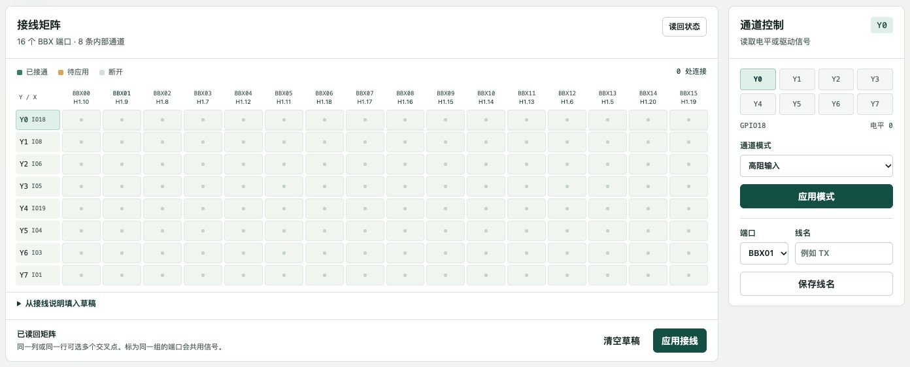

# AI Board 固件

ESP32-C3 提供 AP 配网、UART0 Console、局域网 HTTP RPC 和双分区 OTA。烧录引导期间，GPIO9 保持输入。断开 DTR→BOOT 飞线并明确启用矩阵后，GPIO9 才作为 CH446Q 时钟。

AI Board 让 AI 在真实硬件上编写、烧录和验证嵌入式代码。首次接好目标板和外设后，AI 通过目标板的下载接口烧录，通过 CH446Q 切换接线、读取外设或采集信号，再根据实测结果修改代码并复测。

完整参数和返回值见 [CLI 接口](docs/CLI.md) 和 [Lua 接口](docs/Lua.md)。[ChatGPT 技能](skills/ai-board-embedded-debug/SKILL.md) 与 CLI 共用 `tools/`，运行 `python3 tools/package_skill.py` 可打包技能。

## 工作台截图



[250 Hz PWM 回环波形](docs/images/pwm-loopback.jpg) · [Lua 编辑器与脚本树](docs/images/lua-workspace.jpg)

## 首次通过 USB 烧录

从仓库根目录运行。如果工作区路径含中文，ESP-IDF v6.1 的交叉编译器可能无法读取该路径下的 GCC specs。将源码暂存到 ASCII 路径可规避这个问题。后续每次更改源码，都从仓库同步到暂存目录再编译。

```sh
source ~/.espvm/espvm.sh
espvm use v6.1
stage=$(mktemp -d /tmp/ai-board.XXXXXX)
cp -R CMakeLists.txt dependencies.lock partitions.csv main sdkconfig.defaults tools web "$stage/"
cd "$stage"
idf.py -DIDF_TARGET=esp32c3 build
cd build
python ../tools/serial_bootstrap.py /dev/cu.usbmodemYOURBOARD
```

首次烧录使用现板的 RTS→EN 和 DTR→BOOT 直连，写入 Bootloader、分区表、OTA 初始数据和 `ota_0` 应用。启动日志会打印 AP 名称和设备访问密钥。该密钥用作 WPA2 密码和写入类 RPC 的 `X-Board-Key` 请求头。请保管好含密钥的串口日志。

构建会从组件仓库获取固定版本的 [Espressif Lua 5.5.1](https://components.espressif.com/components/espressif/lua/versions/5.5.1/readme)。请用新暂存目录让 ESP-IDF 从 `sdkconfig.defaults` 生成配置。板卡通过 IPv4 提供 HTTP，保留 WPA2 AP 和 WPA2/WPA3 STA。

### 从 1 MiB OTA 槽迁移

0.10.1 起使用 `partitions.csv` 中的 4 MiB Flash 布局。两个 OTA 槽各 1.75 MiB，地址为 `0x10000` 和 `0x1d0000`。`workspace` 在 `0x390000` 分配 384 KiB LittleFS，末尾 `0x3f0000` 开始预留 64 KiB。

从旧布局迁移时，先通过串口备份原 Flash 或至少备份 NVS。使用新构建的分区表、`ota_data_initial.bin` 和应用镜像按生成的地址烧录，`nvs` 保持 `0x9000`、16 KiB，并保留其原有字节。常规应用 OTA 适用于已经采用该布局的板子。串口启动 `ota_0` 后，用现有 Wi‑Fi 和设备密钥验证，再进行 `ota_0 → ota_1 → ota_0` 两次 OTA 验收。

0.10.1 实板迁移保留了原 Bootloader。串口回读确认 NVS 完全一致，两次 Wi‑Fi OTA 均成功切换并确认启动。每个槽位均通过镜像哈希、旧设备密钥和 Lua 执行校验。

## 配网和 Console

- **AP 配网**。加入板子的 `AI-Board-xxxxxx`，打开配置页，输入设备密钥和电脑当前所在的 2.4 GHz Wi‑Fi 的 SSID、密码。提交后板子会重启。电脑如果使用双频同名网络，可以留在 5 GHz 频段，前提是路由器把两频段桥接到同一个子网。 [AP 配网页](http://192.168.4.1/)
- **Console 配网**。用下方命令打开 UART0，输入 `wifi` 后按提示输入 SSID 和密码。设备不回显密码，`Ctrl+C` 可以取消输入。保存后板子会重启。输入 `status` 读取当前地址，`help` 查看其他命令。用 `Ctrl+]` 退出宿主机的 miniterm。
- **读取地址**。在 UART 日志里找 `LAN IP`，或连接板载 AP 后访问 `/api/status`。恢复 AP 在目标网络无法连接时仍可用于重配。 [AP 状态](http://192.168.4.1/api/status)

```sh
python -m serial.tools.miniterm --dtr 0 --rts 0 /dev/cu.usbmodemYOURBOARD 115200
```

## 局域网 OTA 验收

首次烧录后可在拆掉 DTR 飞线前验证 Wi‑Fi OTA。日常升级从电脑连接的局域网发起。以下命令以 Wi‑Fi 对应 `en0` 为例。先用 `networksetup -listallhardwareports` 查看实际接口。

```sh
ipconfig getifaddr en0
ipconfig getoption en0 subnet_mask
python3 tools/lan_smoke.py BOARD_IP /path/to/build/ai_board.bin \
  --host-cidr HOST_IP/NETMASK --ssid 'CURRENT_WIFI_NAME'
```

脚本会核对板子的 SSID 和子网，再从电脑直接上传应用镜像。认证后由板子写入备用分区并重启，脚本会确认板子仍可从同一局域网访问、启动分区已切换，并比对运行中固件与上传镜像记录的 ELF SHA‑256。上传文件使用 `ai_board.bin`，即 ESP-IDF 的应用镜像。之后可以用同一脚本验证另一个 OTA 分区。

日常 RPC 可用 `board_rpc.py --url http://BOARD_IP status` 查看状态，用 `diagnostics` 读取运行时长、重启原因、堆内存和 Wi‑Fi 信道，也可用 `ota` 推送应用。局域网 RPC 使用 HTTP，请在可信网络使用。OTA 具备 ESP-IDF 镜像校验和启动回滚。新应用启动 Wi‑Fi 和 HTTP 服务后确认分区，LAN 可达性由上面的推送验收验证。

## 信号工作台

### AI 通过 CLI 接管

AI 使用 `tools/board_rpc.py` 执行接线、GPIO、协议收发、逻辑采集、回环测试、配网和 OTA。命令直接把结果以 JSON 输出到标准输出，参数沿用下方工作台 RPC 表。网页在对应功能页同步显示实际接线、采集波形和协议结果。接管期间，网页和 UART Console 的设备操作由固件拦截，状态读取和结果查看继续可用。

将 `board_url`、`board_key_file`、`board_lease_file` 设为板卡 URL、设备密钥文件和本机的租约文件路径，再运行以下命令。确认 DTR 已断开且 BBX 空载后，CLI 才可带确认参数启用矩阵和运行板内回环。

```sh
board_rpc() {
  python3 tools/board_rpc.py --url "$board_url" \
    --key-file "$board_key_file" --lease-file "$board_lease_file" "$@"
}

board_rpc control acquire --ttl 300
board_rpc workbench
board_rpc arm --confirm-dtr-disconnected
board_rpc workbench i2c_register_table_bench confirm_empty=yes rate=100000 address=72 \
  registers=3601113702223338024455 auto_increment=yes start=54 burst=A55A008031
board_rpc result
board_rpc control release
```

`control status` 可读剩余秒数，`control renew --ttl 300` 可续租。租约时长为 30–1800 秒。主动释放、租约到期且当前操作完成，或板卡重启后，网页恢复控制。已失效的租约凭据会被固件拒绝，CLI 需重新接管才能继续。成功接管时凭据写入权限为 `0600` 的本机文件。多网络接口时可用 `--source-ip` 选定到板卡的本机地址。

`GET /api/control` 返回接管状态和结果版本号。持有设备密钥的观察者可用 `GET /api/workbench` 读接线，或用 `GET /api/workbench/result` 读板卡内存中最近一份 AI 工作台结果。该副本供网页查看，CLI 的原始命令输出可独立保存和处理。

### 通过 Wi-Fi 获取采集数据和日志

采集结束后，`workbench capture`、`workbench uart_receive`、`workbench i2c_slave` 和 `workbench spi_slave` 通过 Wi-Fi 一次返回完整批次。CLI 的 JSON 可直接重定向到本机文件。

```sh
board_rpc workbench capture engine=gpio a=3 ms=100 trigger=manual > capture.json
board_rpc logs --limit 32
board_rpc logs --after 0 --limit 64
```

`logs` 使用设备密钥查询板卡最近 64 条结构化事件，默认返回最新 16 条。事件带有序号、启动后的毫秒数、类别、数字状态和摘要。用上一次收到的最后一个 `seq` 作为 `--after` 值可继续读取。发生重启时从头查询。日志缓存在 RAM，内容包括启动、Wi-Fi、矩阵、自检、采集、Lua 执行状态和更新事件。采集原始数据以及 Lua 的 `print` 输出使用各自的命令结果读取。

### 在板上运行 Lua

AI 持有租约后可运行 `board_rpc lua workflow.lua`，或用 `board_rpc lua -` 从标准输入发送源码。每次调用在 ESP32-C3 启动一个新的 Lua 虚拟机，接线、GPIO 与外设操作由固件执行。可用 Lua 的变量、循环、条件、函数和表编排操作，更换脚本只需再次调用 CLI。

```sh
board_rpc lua - --timeout-ms 5000 <<'LUA'
local state = assert(board.call("state"))
local connected = {}
for index, mask in ipairs(state.routes) do
    if mask ~= 0 then connected[#connected + 1] = index - 1 end
end
print("Connected channels", #connected)
return {armed = state.armed, connected = connected}
LUA
```

- `board.call(op, params)` 调用下方工作台表中的操作。参数是字符串键的表，值可用整数、ASCII 字符串和布尔值。布尔值映射为 `yes` 或 `no`。返回 Lua 值，硬件或参数校验失败返回 `nil, error`，可自行分支或用 `assert` 结束。
- GPIO、PWM、CH446Q 路由、UART、SPI、I²C 主从机、分析仪采集和板内回环沿用现有引脚及接线检查。`board.call("state")` 读回接线和电平。`board.call(op, params, "json")` 可取原始 JSON 字符串，适合较大的四路采集结果。
- `board.sleep(ms)` 以 FreeRTOS tick 粒度让出任务，用于操作之间的等待。高精度总线时序由现有硬件驱动生成。脚本上限为 8 KiB 源码、64 KiB Lua 堆，`--timeout-ms` 可设为 100–10000 ms，默认 5000 ms。固件也限制 Lua 指令数。硬件调用会先完成驱动清理，已完成的硬件修改仍然生效。
- CLI 一次返回 JSON，包含脚本 `return` 的结果和 `print` 的日志。脚本失败时输出错误并以非零状态退出。网页 Lua 页显示从该页面运行的结果。

0.10.0 已在原有分区表上通过 Wi‑Fi OTA 实测。连续下发两份不同的 Lua 脚本，先切换 CH446Q 接线、读取 GPIO 电平并捕获信号，再完成 I²C 递增读回、UART 接收和 SPI 全双工回环。脚本遇到死循环、内存超限或语法错误后，下一份脚本仍可正常运行。

### 保存和运行 Lua 脚本

0.10.2 将脚本保存在独立的 `workspace` LittleFS 分区。设备重启或通过应用 OTA 切换槽位后，可以通过相同名称运行。脚本文件名以英文字母或数字开头，使用字母、数字、点、下划线或连字符，以 `.lua` 结尾，最多 48 个字符。每份脚本最多 8 KiB，目录最多 64 份，实际数量还受分区剩余空间限制。上传同名脚本会在完整写入后替换旧版本。

```sh
board_rpc control acquire --ttl 300
board_rpc script upload workflow.lua ./workflow.lua
board_rpc script list
board_rpc script run workflow.lua --timeout-ms 5000
board_rpc control release
```

`script upload NAME -` 从标准输入读 Lua 源码。CLI 上传和运行要求持有租约，查看列表使用设备密钥即可。CLI 执行结果以 JSON 输出。首次启动时只初始化全空的 `workspace` 分区。

工作台「Lua 脚本」页左侧的「工作区」文件树显示板上 LittleFS 中已保存的脚本。点击文件名可打开源码，当前文件会高亮，切换文件时会提示是否放弃未保存的草稿。「运行」会执行编辑区中的内容，保存由单独的按钮完成。执行结果显示返回值、`print` 日志和脚本错误。如果打开之后板上的同名脚本被更新，保存时会提示重新打开以核对版本。AI 持有接管租约时，网页仍可查看脚本和结果，释放租约后恢复编辑、保存和运行。

打开 Lua 页时，浏览器会通过固定版本及完整性校验的 HTTPS 链接加载 [Ace 编辑器](https://ace.c9.io/#nav=embedding)。编辑器提供 Lua 语法高亮、行号、缩进、折叠和查找。可用 Ctrl 或 Cmd + S 保存、Ctrl 或 Cmd + Enter 运行。有行号的运行错误可以跳回对应源码。板载 AP 等无法访问 CDN 的环境继续使用普通文本框。

### 网页查看与手动操作

访问板子的实际 LAN 地址打开网页。网页和 RPC 都由设备提供，直接访问板载 AP 时可以使用 [工作台](http://192.168.4.1/) 或 [独立配网页](http://192.168.4.1/setup)。网页的设备密钥使用浏览器会话存储。接线预设、BBX 别名和测试记录存放在当前浏览器，记录可导出。

#### 独立更新工作台网页

从 0.10.7 起，CLI 可以把工作台网页发布到现有的 384 KiB LittleFS 分区。目录内需有 `index.html`、`style.css` 和 `app.js`。CLI 为 HTML 中的样式和脚本链接加上版本路径，再将三个文件分别用 gzip 压缩并合并为一套上传。压缩包上限为 96 KiB。

```sh
board_rpc web status
board_rpc control acquire --ttl 300
board_rpc web upload web
board_rpc control release
```

0.10.9 起，LittleFS 只保留当前网页包。上传期间另外占用一个临时包的空间。整套文件通过校验后立即切换，并清理旧包。断线或校验失败时，当前网页继续可用。网页与 Lua 脚本共用 LittleFS 容量。

刷新工作台即可看到新界面，板卡无需重启。访问 `/recovery` 可打开固件内置工作台，`/setup` 提供配网。需要恢复某套自定义页面时，可以用 CLI 重新上传对应的本地文件。RPC 或驱动变更通过固件 OTA 更新。

- **编排接线**。16×8 交叉点可以独立开关，支持同列和同行多选。比如 `BBX02→Y3, BBX02→Y4` 将同一根外部信号接到两个 Y，`BBX02→Y3, BBX07→Y3` 将两根 BBX 线直通。工作台按电气连通关系显示分组，CLI 和 Lua 使用相同的路由掩码。检查草稿和外部线序后再应用。矩阵重启后清空。
- **直接通信**。支持 3.3 V UART 8N1 收发、100 kHz I²C 扫描和单字节寄存器读，以及 1–20 kHz SPI 模式 0。一次协议操作最多处理 64 字节。不同协议角色必须接到不同的电气网络，每个网络使用一个 BBX，可附加高阻输入 Y。启动协议前，选中的 Y 须为高阻输入，整个网络不能有已启用的 GPIO 输出。确认外设方向后再驱动输出。I²C 使用外部 3.3 V 上拉。
- **旁听和接管**。把主控和外设的同一条信号接到同一 Y，并使用高阻输入捕获。手动点击即开始，或在任意选中的 A–D 通道等待指定上升沿或下降沿，边沿发生时为 t=0。可等待 100 ms–5 s。最多四个 Y、每路 256 个边沿。GPIO 长窗口模式为 10–500 ms。硬件模式由 SPI2 Quad RX 和 GDMA 用同一内部时钟采样四路，可缓存 65,536 个采样点，20 MS/s 时窗口最长约 3.28 ms。固件采集结束后一次性返回数据，网页可导出 1 ns 时间基准的 VCD。硬件边沿触发会标出从触发边沿到硬件启动之间的估算间隔。无需丢开头的短帧测试可先手动采集，再发起交易。四线 SPI 按 A=CS（低有效）、B=SCK、C=MOSI、D=MISO 采集，可选 Mode 0–3 和 MSB/LSB 优先并分别查看 MOSI/MISO 字节。可尝试识别 UART 8N1 波特率或指定波特率，或按确认的 SCL/SDA 方向在网页解读 I²C。需要分离两端时，将四根 UART 信号分别接到四条 Y，可运行有等待上限的单次请求应答代理。
- **回归测试**。运行一次协议动作后，可保存这次动作、接线和预期响应。重新接线并确认端口后，从预设重放并比较结果。矩阵、UART 和 SPI 板内回环需让 BBX 电气空载并清空路由。
- **OUT 供电**。从 0.10.11 起，默认启用 `CONFIG_AI_BOARD_OUT_CONTROL`。在「接线矩阵」页的「OUT 供电」卡片可以切换 H1.4 的 5 V 供电和 GND 放电。放电模式关断 5 V，并通过 R9 的 330 Ω 电阻下拉 OUT。模式读回来自 CTRL，实际电压可以在 H1.4 测量。
- **GPIO**。支持输入、上下拉、高低电平输出和单路 100 Hz–20 kHz PWM。一个输出网络须只有一个 BBX，允许多个输入 Y 读取同一信号，固件拒绝在同一网络启用第二个输出。BBX 与 ESP32-C3 直通，连接信号按共地和 3.3 V 兼容设计。应用新拓扑前，固件先释放所有 Y 并断开旧路由。

程序或 AI 可复用同一地址的 RPC。先使用 `GET /api/workbench` 读回当前路由和引脚模式，再向该地址发送 URL 编码的请求体。所有工作台操作带 `X-Board-Key`。

| 操作 | 请求体参数 |
| --- | --- |
| 改接或清空 | `op=route` 和 `y0` 至 `y7` 的 16 位掩码，或 `op=reset` |
| OUT 供电 | `op=power&mode=5v` 或 `op=power&mode=gnd` |
| GPIO / PWM | `op=gpio`、`y`、`mode`，PWM 带 `hz` 与 `duty` |
| UART | `op=uart`、`tx`、`rx`、`baud`、`hex`、`read`、`timeout` |
| I²C | `op=i2c_scan`、`sda`、`scl`。读寄存器用 `op=i2c_read`，增加 `address`、`reg`、`count` |
| I²C 主机传输 | `op=i2c_transfer`、`sda`、`scl`、`address=8..119`、`hz=5000..400000`、`read=0..64`、可选 `hex`（最多 64 字节）。写入和读取同时指定时在一次交易中使用重复 START |
| SPI | `op=spi`、`sck`、`mosi`、`miso`、`cs`、`hz`、`hex` |
| SPI 从机采集 | `op=spi_slave`、`cs`、`sck`、`mosi`、`miso`（仅接收填 -1）、`mode=0..3`、`order=msb/lsb`、`bytes=4..64`（4 的倍数）、`count=1..8`、`wait_ms=100..5000`。全双工增加 `reply`（HEX 字节） |
| SPI 从机压测 | `op=spi_slave_bench`、`confirm_empty=yes`、`phase=rx/duplex/gap`。单收和全双工 `hz=10000..20000000`，连续帧 `hz=10000..3333334` 并增加 `gap_ns=150..1000000` |
| I²C 从机采集 | `op=i2c_slave`、`sda`、`scl`、`address=8..119`（十进制）、`bytes=1..64`、`count=1..8`、`wait_ms=100..5000` |
| I²C 固定寄存器应答 | 在 `op=i2c_slave` 增加 `register=0..255`（十进制）和 `reply`（1–32 字节 HEX），设 `count=1` |
| I²C 重复起始压测 | `op=i2c_register_bench`、`confirm_empty=yes`、`address`、`register`、`reply`、`rate=10000..400000` |
| I²C 寄存器表应答 | 在 `op=i2c_slave` 增加 `registers`，`count` 为要采集的读交易数。每项用 HEX 编码一个字节的寄存器地址、一个字节的应答长度，再接相应长度的应答字节。例如 `2301A59A025A00` 配置 `0x23 → A5` 和 `0x9A → 5A 00` |
| I²C 寄存器表回环 | `op=i2c_register_table_bench`、`confirm_empty=yes`、`address`、`registers`、`rate=10000..400000`。可选 `writes` 与 `registers` 编码相同，指定各寄存器在回环中要写入的新值 |
| I²C 地址自动递增 | 外接主机采集增加 `auto_increment=yes`。板内回环增加 `auto_increment=yes`、`start=0..255`（十进制）和 `burst`（1–32 字节 HEX）。每笔结果的 `registers` 按地址列出各段数据 |
| UART 接收 | `op=uart_receive`、`rx`、`baud=9600..5000000`、`bytes=1..2048`、`wait_ms=100..5000`、`idle_ms`（0 禁用，或 10–1000 且不超过 `wait_ms`） |
| I²C / UART 接收压测 | `op=protocol_receive_bench`、`confirm_empty=yes`、`mode=i2c/uart`、`rate`。I²C 10–400 kHz，UART 9600–5000000 baud |
| 数字采集 | `op=capture`、`a`（必选）、`b/c/d`（不用时可省略或为 -1）、`engine=gpio&ms=...` 或 `engine=dma&sample_hz=20000000&window_us=3000`，`baud`（0 表示自动）、`trigger=manual/rising/falling`，边沿模式还需 `trigger_channel=0..3`（A–D）和 `wait_ms` |
| 单轮 UART 代理 | `op=proxy`、`host_tx`、`host_rx`、`device_tx`、`device_rx`、`baud`、`timeout` |
| 板内回环 | `op=uart_loopback`、`op=i2c_host_capture`、`op=spi_host_capture`。均需 `confirm_empty=yes` |

Wi‑Fi 是默认传输。使用串口时，先配置路由并启用矩阵，再通过 UART0 的 Console 请求采集。板子只在采完后输出一份 JSON。用 ESP-IDF 的 Python 运行下方命令，生成的文件可在网页的「信号捕获 → 导入 JSON」绘图、重解码或导出 VCD。

```sh
python tools/serial_capture.py /dev/cu.usbmodemYOURBOARD 0 1 2 3 \
  --trigger falling --trigger-channel A --wait-ms 3000 --ms 150 --output capture.json
```

### 波形分析

采集完成后，可在「信号捕获」的「波形分析」中使用滚轮或缩放按钮调整时基，拖动波形平移，点击总览定位，或用「全览」回到整段记录。拖动总览上高亮窗口的左右边界可改变起止位置，拖动窗口中部可平移。也可以在总览下方输入起止时间（ms），点击「应用」精确定位。选择游标 A、B 后点击波形放置游标，拖动可以调整位置，靠近边沿时会吸附。选择测量通道后可按边沿跳转并统计游标之间的升降沿。指向完整脉冲可读取脉宽、周期、频率和占空比。I²C、SPI 交易可从解码列表定位到波形，UART 字节能与采集边沿对齐时显示在时间轴上。

导入板卡采集的 JSON 也可使用这些操作。测量基于有效样本区间，触发后尚未开始采样或边沿记录截断的区域会以遮罩标出。

### 硬件采集实测

在 BBX 空载的板内回环中，使用 20 MS/s、3 ms 手动窗口。UART 8N1 设为 4,000,000 baud、I²C 主机设为 400 kHz（采到的 SCL 约 333 kHz）、SPI Mode 0 双向回环实测 2.5 MHz，均完整解码 30/30 次。I²C 响应是空载地址 NACK，SPI 是四字节回环。启用硬件采样后，SPI2 只作输入采样，SPI 压测信号由同步 RMT 输出。

20 MS/s 下手动窗口最长约 3.28 ms。要从帧开头读取高速 UART 或 I²C，可在采集窗口内安排设备发出请求。边沿触发同时记录 GPIO 触发点和硬件开始采样的估算偏移，偏移前的区间可能含未记录的边沿。

### 主机信号经矩阵验收

在 BBX 空载、矩阵清空时，通过网页的主机采集入口运行。测试结束后固件会撤掉内部连接。

| 主机 | 经 CH446Q 后由独立 GPIO 采集 | 预期 |
| --- | --- | --- |
| UART1 | Y7 发送经 X0 到 Y2（UART1 RX）与 Y4（采集） | 9600 baud，`55 A6 00 FF C3 46` |
| I²C | Y0/Y1 的 SCL/SDA 经 X0/X1 到 Y4/Y5 | 5 kHz，START → 地址 0x48 写 → NACK → STOP，空载时地址无应答 |
| SPI | CS、SCK、MOSI、MISO 分别接至 Y4–Y7，MOSI 经矩阵回接主机 MISO | Mode 0、10 kHz，双向均为 `9F 00 00 A5` |

### SPI 从机

将外部 3.3 V 主机共地，把 CS、SCK、MOSI 分别通过 CH446Q 接到独立的 Y。全双工再给 MISO 分配独立的 Y，并配置每次 CS 拉低时返回的固定字节。应答短于容量时在尾部补零。在「协议接收」选择「SPI 从机」，配置参数并启动，再让主机发送。主机每帧发送 4 的整数倍字节，CS 低有效。SPI2 按主机时钟收发，把完整帧放进 DMA 缓冲。达到目标帧数或等待超时后，经 Wi‑Fi 一次返回已收到的所有帧和每帧位数。批次占用 SPI2，完成后可重新使用「信号捕获」的硬件采样模式。

板内压测需清空路由并确认 BBX 空载。主机生成 Mode 0、MSB 优先的 32 位帧，经 CH446Q 接到 SPI2 从机。3.333 MHz 及以下由 RMT 生成。更高的单帧频率由 I²S 硬件产生，发送一次后停止。全双工时 MISO 经过另一条矩阵通路，由 I²S 采样后逐字节校验。连续帧结果的间隔是夹具设置的 CS 高电平时间，测试完成后固件清除内部路由。

RMT 的每个非零相位必须长于 5 个 APB 周期加 6 个 RMT 源时钟周期。切换到 80 MHz APB 后，固件保证每相位至少 12 tick（150 ns），因此 50% 占空比的 RMT SCK 上限约为 3.333 MHz。 [ESP32-C3 技术参考手册，式 33.1](https://documentation.espressif.com/esp32-c3_technical_reference_manual_en.pdf#page=845)

0.7.1 实测经 CH446Q 的 20 MHz 单帧有一次 CS 选中、32 个 SCK 上升沿和完整 MOSI 字节。交付固件在此频率下 MOSI 单收 200/200，全双工 200/200，逐帧校验 MOSI `9F 51 36 A5` 和全双工应答 `D2 69 8B 54`。实验性 20.25 MHz 设置已在夹具的 MOSI 波形上观察到位错误，交付版的单帧压测限于 20 MHz。

0.7.0 的双帧测试在 2.857 MHz、26 µs CS 高电平间隔通过 240/240 组，在 25.75 µs 通过 119/120 组。CS 再次拉低后，夹具留有 1 µs 的 SCK 启动前置时间。

### I²C 从机和 UART 接收

在「协议接收」页选择协议，应用接线后启动，再由已知协议的主机发送。使用 3.3 V 逻辑并共地。每次采集结束后经 Wi‑Fi 返回一份批次结果。

- **I²C 从机**使用 I2C0，对指定的 7 位地址应答并保存主机写入。SDA 和 SCL 各用独立的 Y，接线需有外部 3.3 V 上拉。每个数据写入用独立的 START/STOP，每批最多 8 帧，每帧保留最多 64 字节。超时保留已结束的写入。
- **I²C 寄存器表**在同一页启用，可一次配置 1–8 个单字节寄存器地址和各自的 1–32 字节初值。主机只写寄存器地址时会选中这一项。地址后带 1–32 字节数据时会替换该项的完整值。随后发重复 START 切到读方向，按当前值的长度读回，最后发 NACK 和 STOP。更新保留在本批次内，下次采集从配置的初值开始。批次采完或超时后经 Wi‑Fi 一次返回，交易记录包含写入、是否生效、应答和读阶段状态。
- **寄存器表板内回环**使用每行可选的「测试写入（HEX）」字段。夹具按表格顺序执行每项，填写新值的项会写入再读回，留空的项会读取当前值。批次余下的交易名额用于重新选择已写入的寄存器，检查写入是否保留。网页逐笔显示实际写入和主机经 CH446Q 实际读回的字节。
- **地址自动递增**以每项初始值的字节数为固定宽度。主机只发一次起始寄存器地址，按地址顺序写入后续数据，通过一次重复 START 读回同一段。一次最多覆盖 8 项、合计 32 字节，结束地址最大为 `0xFF`。只有完整覆盖相邻寄存器的写入才生效。只发送起始地址时，可按相同顺序读取从该地址开始的连续完整寄存器，最多应答 32 字节。板内回环可填写起始地址和连续写入数据，网页按地址显示实际写入及主机读回，整批仍在结束后通过 Wi‑Fi 一次返回。
- **UART 接收**使用 UART1，以 8N1 从一个 Y 接收已知波特率的信号。每批最多 2048 字节，到达容量、空闲间隔或总超时时结束。结果含实际波特率、帧错误及接收溢出等状态。

板内压测以 BBX 空载、矩阵清空为前提。I²C 主机使用开漏 GPIO 发送两次、每次 64 字节的地址写入并检查 ACK，界面报告从实际 SCL 上升沿计算的平均频率。UART 主机使用独立的 RMT 时钟经 CH446Q 发送 32 字节，接收端逐字节校验。

0.8.0 经 CH446Q 实测。I²C 从机在 400 kHz 目标档的实际 SCL 中位数约 371 kHz，两帧 64 字节写入通过 60/60 组。UART 在 5 Mbaud 通过 100/100 组 32 字节板内压测。使用单独的 I²S 发包夹具经同一矩阵通路发送连续 2048 字节，在 5 Mbaud 通过 30/30 组。

0.8.1 的寄存器读回在 100 kHz 和 400 kHz 目标档各通过 60/60 组，覆盖 1、4、16 和 32 字节应答。包含重复 START 和时钟拉伸的实测平均 SCL 中位数分别约为 92 和 279 kHz。10 MS/s 独立采样确认地址 `0x48` 下写入 `23` 后直接重复 START，主机读回 `A5 5A 00 80`，在末字节后发 NACK 和 STOP。

0.8.2 的寄存器表经 CH446Q 实测，在 100 kHz 和 400 kHz 目标档各通过 60/60 批，包含 8 个寄存器各读回 32 字节的批次。包含重复 START、字节交接和时钟拉伸的实测平均 SCL 中位数分别约为 89 和 257 kHz。10 MS/s 独立采样确认了连续三笔交易，写入 `23`、`9A` 和 `01` 后分别经重复 START 读回 `A5`、`5A 00` 和 `80`。网页用同一组地址实测，每笔均显示主机写入和实际读回。

0.8.3 的寄存器表读写经 CH446Q 实测，在 100 kHz 和 400 kHz 目标档各通过 60/60 批，涵盖三项写入后复读、部分寄存器保持初值，以及八项各写入并读回 32 字节。实测平均 SCL 中位数约为 89 和 259 kHz。10 MS/s 采样确认向 `0x23` 写入 `A5` 后直接重复 START 读回 `A5`，访问其他寄存器后仍可复读新值。

0.8.4 的自动递增回环经 CH446Q 实测，在 100 kHz 和 400 kHz 目标档各通过 60/60 批，覆盖混合宽度、8 个地址合计 32 字节及结束地址 `0xFF`。实测平均 SCL 中位数约为 94 和 286 kHz。10 MS/s 采样在两档均确认写入 `36 A5 5A 00 80 31` 后只发出一次重复 START，实际读回 `A5 5A 00 80 31`。网页按 `0x36`、`0x37`、`0x38` 显示对应字节。跨越未配置地址的总线写入也已验证，随后只发送起始地址回读时，各寄存器仍保持原值。

## 断开 DTR 和矩阵验收

等 AP 恢复配网、Console 配网和局域网 OTA 切换都验证后，再断电、拆掉 DTR→BOOT 飞线并重新上电。RTS→EN 可以保留。开始自检前让 BBX 保持空载。

- **Console** 先运行 `arm dtr-disconnected`，再运行 `selftest`。
- **RPC** 依次运行下列命令。每次重启后，需要重新启用矩阵。

```sh
python3 tools/board_rpc.py --url http://BOARD_IP arm
python3 tools/board_rpc.py --url http://BOARD_IP selftest
```
